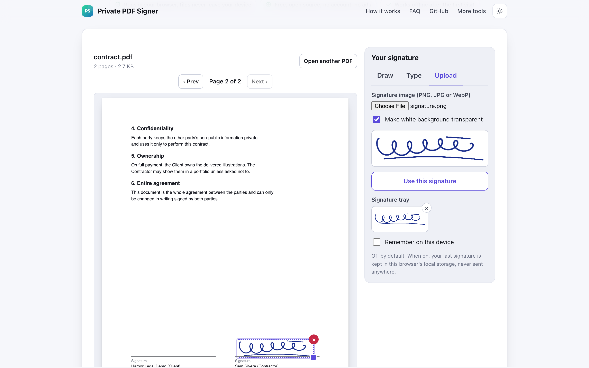
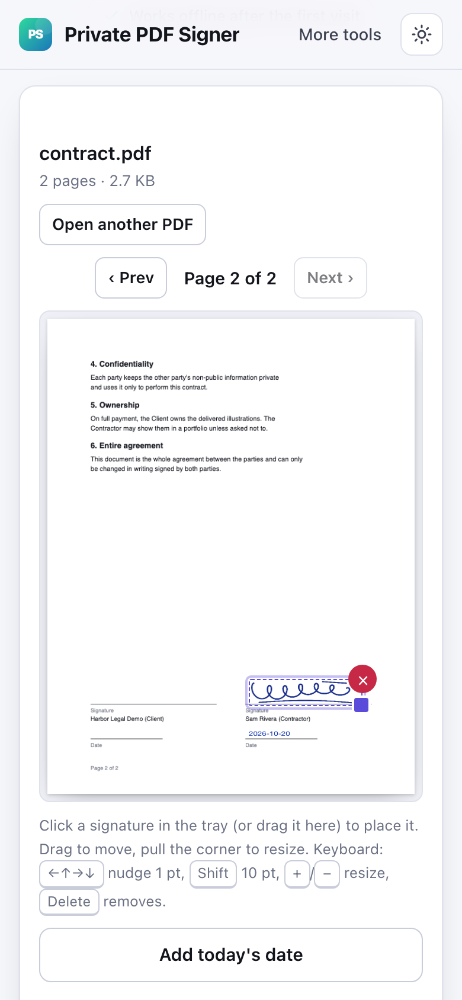

# Private PDF Signer

> Draw or type your signature and place it on a PDF page in your browser, with no account and no upload.

**🌐 Use it now: [turhe123.github.io/sign-pdf-private](https://turhe123.github.io/sign-pdf-private/)** · free · open source · runs in your browser · works offline


## Why

Private PDF Signer is a free, open-source alternative to Smallpdf eSign PDF and the DocuSign free plan, which upload your contract, require an account and limit free signing to a couple of documents per day or month. Here your files never leave your device, there is no account, no ads and no limits, and it works offline and can be installed as an app.

## Screenshots

<p align="center"></p>

<p align="center"><em>Private PDF Signer in the browser, light theme</em></p>

<p align="center"></p>

<p align="center"><em>Private PDF Signer on a phone</em></p>

## Features

- Open one PDF by dropping it on the page or choosing it; the file is read into the tab's memory only.
- The current page is rendered with pdf.js and a page stepper (Prev / Next); only the visible page is rendered to save memory.
- Three ways to create a signature:
  - **Draw** on a pad with mouse, finger or pen (smooth lines, high-DPI aware, touch scrolling prevented, Clear button).
  - **Type** your name in three built-in styles (Script, Handwriting, Italic) that use generic system fonts.
  - **Upload** a PNG, JPG or WebP image, with an option to make a white background transparent.
- Pen color: blue (default) or black, for drawn and typed signatures.
- Signatures are cropped to their ink bounds and kept as transparent PNGs in a tray (up to 6 recent ones). Click a tray item, or drag it onto the page, to place it.
- Drag placed items to move them, pull the corner handle to resize, or use the delete button.
- Keyboard: arrow keys nudge a selected item by 1 pt, Shift+arrows by 10 pt, `+` / `-` resize, Delete removes it, Escape deselects.
- "Add today's date" stamps the date (YYYY-MM-DD) as text in the current pen color.
- Multiple placements across multiple pages in one save.
- Save PDF writes `name_signed.pdf` with pdf-lib in a Web Worker; the original file is not modified. Page rotation is accounted for.
- Optional "Remember on this device" keeps your last signature in local storage (off by default; unticking deletes it).
- Light and dark themes, responsive down to phone widths, installable as a PWA.

**Input:** one PDF (unencrypted), plus PNG, JPG or WebP for an uploaded signature.
**Output:** a PDF with the signature image and date text drawn on the chosen pages.
**Limits:** this is a visual signature only, not a cryptographic digital signature, and it does not lock the document. Password-protected / encrypted PDFs are not supported. One PDF at a time.

## How to use

1. Open your PDF by dropping it on the page or choosing it.
2. Create your signature on the right: draw it, type it or upload an image, then press **Use this signature**.
3. Click the signature in the tray (or drag it onto the page), then drag it into position and pull the corner to resize. Optionally press **Add today's date**.
4. Press **Save signed PDF** to download `name_signed.pdf`.

## Privacy

- Nothing is uploaded. Your PDF and signature are processed in your browser and never sent to a server.
- No cookies.
- Page views are counted anonymously with [GoatCounter](https://www.goatcounter.com/) (cookieless, open source). This is the only network request the page makes besides its own files.
- Works offline after the first visit through a service worker.

## Run it locally

```sh
git clone https://github.com/turhe123/sign-pdf-private
cd sign-pdf-private
python3 -m http.server 4173
```

Then open http://127.0.0.1:4173/. There is no build step.

## Tests

```sh
npm i -D @playwright/test && npx playwright install chromium
npx playwright test
```

## Third-party code

Vendored in `vendor/`, each with its license file:

- [pdf-lib](https://github.com/Hopding/pdf-lib) 1.17.1, MIT
- [pdfjs-dist](https://github.com/mozilla/pdf.js) 4.10.38, Apache-2.0

## Built with AI

Private PDF Signer was written by [Claude Code](https://claude.com/claude-code) inside an automated pipeline, from a plain-English spec. No code or assets from any commercial product were used; it is a clean-room implementation of a feature set, not a copy.

What that means in practice:

- The full source is in this repo under the MIT license. Read it before you trust it with your files.
- Everything runs in your browser. It makes no network requests except an anonymous, cookieless page-view count (GoatCounter); your files never leave the device.
- The page is tested headless in Chromium (Playwright) before every release, but it has had less human review than hand-written software. Bug reports and pull requests are welcome.

## Support ❤️

If this saves you a paid subscription, you can say thanks on [Ko-fi](https://ko-fi.com/leodavidai).

## More free web tools

See the rest at [turhe123.github.io/web-tools](https://turhe123.github.io/web-tools/).

## License

MIT © Or Davidai Bachar
